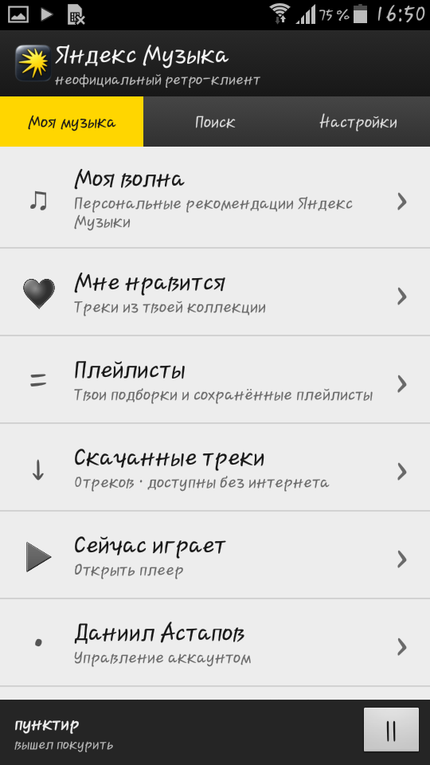

# OldYM


**Язык:** Русский | [English](README.en.md)

Неофициальный клиент Яндекс.Музыки для Android 2.0+. Не связан с Яндексом.

## Процессоры ARMv6 и ARMv7

Один APK для обеих архитектур: приложение и TLS-библиотеки содержат Java/DEX, нативных `.so` внутри нет. `minSdkVersion=5`, DEX 035. Проверки Android 2.0 прошли на эмуляторе ARM926EJ-S (ARMv5TEJ, `armeabi`), то есть приложение не требует инструкций ARMv7. Приложение проверено на следующих ARMv6 и ARMv7 устройствах:
- Samsung Galaxy Ace (Android 2.3.6)
- LG Optimus Me (Android 2.2)
- LG Optimus Sol (Android 4.0.4)
- Samsung Galaxy S II (Android 4.0.4)
- Honor 7 (Android 5.0.2)

## Установка и вход

1. Перенеси APK OldYM на телефон (для собственной сборки см. раздел «Сборка: Windows и Linux»). Разреши установку из неизвестных источников в настройках Android и открой APK через файловый менеджер.
2. Открой приложение и на экране нажми "Войти по коду устройства"
3. Приложение покажет код и адрес страницы Яндекса. Открой показанный адрес на современном телефоне или компьютере, войди непосредственно на сайте Яндекса и введи код. Вернись к устройству, на котором OldYM: приложение ожидает подтверждения автоматически.
4. Альтернатива — вставить собственный OAuth-токен с доступом к Музыке. Не отправляй токен другим людям и не вставляй его в посторонние сайты.

Компьютер может понадобиться только для подтверждения входа, если старый браузер не открывает сайт. Постоянно включённый ПК, сервер-посредник и root не нужны. Сеть и TLS 1.2 реализованы непосредственно внутри APK. Проверка цепочки сертификатов и имени сервера включена. На телефоне должны быть верно выставлены дата и время.

## Возможности

- Обложки в плеере: увеличение лимита загрузки и запасные размеры изображения для старых устройств.
- Просмотр избранных треков и кнопка добавления/удаления лайка в плеере.
- Собственные и сохранённые плейлисты: список и прослушивание.
- Показ треков по избранному/результатам поиска постранично: сначала 20 результатов, затем по 20 через кнопку «Загрузить ещё 20 треков» (в «Моей волне» по 5 треков).
- «Моя волна» — загрузка персональных рекомендаций с Яндекс Музыки.
- Плеер: пауза, следующий/предыдущий трек, перемотка, перемешивание списка, фоновое воспроизведение.
- Скачивание отдельного трека или всего открытого списка.
- Раздел скачанной музыки.
- Вход по коду устройства и вручную по токену.

Возможности аккаунта, подписка, региональные ограничения и доступность полного MP3 проверяются сервисом. Приложение не обходит эти ограничения. Совместимость с неофициальным API может измениться.

## Имеющиеся ограничения
- Перед воспроизведением новый онлайн-трек скачивается целиком во временный буфер. Это не потоковый старт; первая загрузка может занять время.
- Офлайн-загрузки выполняются по очереди, пока приложение открыто. Не закрывай его во время скачивания плейлиста.
- Предпочтительно MP3 128 кбит/с, если такой вариант доступен; кодеки и DRM-варианты не конвертируются.
- Создание/редактирование плейлистов, текст песен и синхронизация устройств не реализованы. Получение и управление треками «Моей волны» зависят от неофициального API.
- Токен хранится в приватных данных приложения, не аппаратно зашифрован; root-доступ позволяет его прочитать. Старые Android сами по себе не получают современных исправлений безопасности.
- Музыка сохраняется в `Android/data/ru.oldym/files/music` на карте памяти, при её отсутствии — во внутренних данных приложения. Обложки кешируются отдельно.
- Проверка HTTPS не включает онлайн-проверку отзыва сертификатов; корневые сертификаты включены в APK и обновляются новой сборкой.

## Сборка: Windows и Linux

Сборка выполняется без Gradle. Обе системы используют один сценарий `tools/build_portable.py`; `build.cmd` и `build.sh` — оболочки для него. По умолчанию создаётся **неподписанный** APK: пароль не запрашивается и закрывать окно для остановки подписи не нужно. Для установки APK необходимо подписать собственным ключом.

### Требования

- **JDK 11**, а не только JRE. Переменная `JAVA_HOME`, если задана, должна указывать на корень JDK, без `bin` в конце. Другие версии JDK этой инструкцией не проверялись.
- **Python 3.8+**; на Windows также нужен Python Launcher с командой `py -3`.
- Полный исходный проект: `src/`, `res/`, `assets/`, `tools/`, `AndroidManifest.xml` и `proguard.cfg`. Один README или архив только с Java-файлами недостаточен.
- На **Windows x64** дополнительно нужен нативный `aapt.exe` из **Android SDK Build Tools 28.0.3**. Установи этот компонент через Android SDK Manager: SDK Tools → Show Package Details → Android SDK Build-Tools → 28.0.3. Сам Android Studio для компиляции не требуется. Папку SDK можно указать через `ANDROID_SDK_ROOT`, а конкретный исполняемый файл — параметром `--aapt`. Сохрани рядом остальные DLL из комплекта Build Tools.
- На **Linux x86-64** используется вложенный `tools/sdk/android-9/aapt`; Windows-файл `aapt.exe` там не нужен. На других архитектурах вложенный исполняемый файл не заработает: понадобится подходящий `aapt` и отдельная проверка сборки.

В `tools/` уже должны находиться `android.jar` API 5, `dx.jar`, `apksigner.jar`, ProGuard и библиотеки Bouncy Castle. Не заменяй их произвольными новыми версиями: текущая цепочка рассчитана на старый Android.

Для первого запуска удобно распаковать проект в короткий путь без кириллицы, например `C:\OldYM` или `~/OldYM`. Все команды ниже выполняются **из корня проекта**, где лежит `AndroidManifest.xml`.

### Windows: проверка среды и неподписанная сборка

Открой **командную строку cmd** в папке проекта. Следующие команды написаны для cmd, не для PowerShell. Подставь свой путь к установленной JDK:

```bat
set "JAVA_HOME=C:\Java\jdk-11"
"%JAVA_HOME%\bin\javac.exe" -version
py -3 --version
```

Если Android SDK установлен не в стандартную папку, укажи его расположение:

```bat
set "ANDROID_SDK_ROOT=C:\Android\Sdk"
```

Собери APK:

```bat
build.cmd --unsigned
```

Результат: `build\unsigned.apk`. Он ещё не пригоден для установки. Сборщик ищет `aapt.exe` в `tools\windows\`, SDK из `ANDROID_SDK_ROOT` / `ANDROID_HOME`, затем в `%LOCALAPPDATA%\Android\Sdk\build-tools\28.0.3\`. Для явного пути:

```bat
build.cmd --unsigned --aapt "C:\Android\Sdk\build-tools\28.0.3\aapt.exe"
```

### Linux: проверка среды и неподписанная сборка

Установи JDK 11 и Python 3 средствами своего дистрибутива. Проверь:

```sh
java -version
javac -version
python3 --version
```

При нескольких JDK задай путь к версии 11, подставив фактическую папку:

```sh
export JAVA_HOME=/path/to/jdk-11
export PATH="$JAVA_HOME/bin:$PATH"
```

Собери APK:

```sh
sh build.sh --unsigned
```

Результат: `build/unsigned.apk`. Сборщик сам добавляет право запуска вложенному Linux-файлу `aapt`. Запуск с файловой системы, смонтированной с `noexec`, всё равно невозможен — перенеси проект на обычную файловую систему.

### Создание личного ключа подписи

**Если ключ уже есть, новый создавать не нужно.** Используй тот же файл и alias, которыми подписаны предыдущие выпуски. Ключ создаётся один раз, а не перед каждой сборкой.

Ключ удобно держать **вне репозитория**. Пример для Windows (cmd):

```bat
if not exist "%USERPROFILE%\.oldym" mkdir "%USERPROFILE%\.oldym"
"%JAVA_HOME%\bin\keytool.exe" -genkeypair -storetype JKS -keystore "%USERPROFILE%\.oldym\oldym-release.jks" -alias oldym -keyalg RSA -keysize 2048 -sigalg SHA256withRSA -validity 10000
```

Пример для Linux:

```sh
mkdir -p "$HOME/.oldym"
keytool -genkeypair -storetype JKS -keystore "$HOME/.oldym/oldym-release.jks" -alias oldym -keyalg RSA -keysize 2048 -sigalg SHA256withRSA -validity 10000
```

`keytool` интерактивно запросит пароль хранилища и данные владельца сертификата. Ввод пароля не отображается — это нормально. Для самостоятельного распространения APK не требуется сертификат от платного удостоверяющего центра. Данные сертификата видны другим людям: не указывай домашний адрес и другие лишние личные сведения. При запросе пароля самого ключа можно нажать Enter, чтобы использовать пароль хранилища.

- `oldym-release.jks` — хранилище с приватным ключом; его нельзя публиковать.
- `oldym` — alias, то есть имя ключа внутри хранилища; это не пароль и не идентификатор Android-пакета.
- `10000` — срок действия сертификата в днях.
- Сохрани приватную резервную копию файла, alias и пароля. Пароль без файла ключа не позволит подписывать обновления, а файл без пароля тоже может оказаться бесполезен.
- Никогда не прикладывай ключ к GitHub Releases, исходникам или сообщениям об ошибках. Официальный ключ проекта и OAuth-токены пользователям для самостоятельной сборки не нужны.

Вместо ручной команды можно использовать оболочку: `create-key.cmd` на Windows или `python3 tools/build_portable.py --create-key` на Linux. По умолчанию она создаёт тот же `~/.oldym/oldym-release.jks` с alias `oldym` и отказывается перезаписывать существующий файл. Для своего расположения добавь `--keystore`, для другого alias — `--alias`.

### Сборка и подпись собственным ключом

Windows (cmd):

```bat
build.cmd --keystore "%USERPROFILE%\.oldym\oldym-release.jks" --alias oldym
```

Linux:

```sh
sh build.sh --keystore "$HOME/.oldym/oldym-release.jks" --alias oldym
```

После компиляции `apksigner` запросит пароль. Не вписывай пароль в команду или исходники. Если у ключа отдельный пароль, инструмент может запросить и его.

Результаты:

- `build/unsigned.apk` — промежуточный APK без подписи.
- `build/OldYM-<versionName>.apk` — подписанный APK для установки; версия берётся из `AndroidManifest.xml`, например `OldYM-1.1.apk`.
- `build/shrink.log` — журнал ProGuard.

Подпись автоматически проверяется, а в терминале выводится информация о сертификате. Используется RSA и подпись **v1/JAR**, необходимая Android 2.x; отсутствие подписи v2 в этой сборке не означает ошибку. Не меняй содержимое APK после подписи.

Если `unsigned.apk` уже собран, повторная компиляция не требуется:

```bat
py -3 tools\build_portable.py --sign-only build\unsigned.apk --keystore "%USERPROFILE%\.oldym\oldym-release.jks" --alias oldym
```

```sh
python3 tools/build_portable.py --sign-only build/unsigned.apk --keystore "$HOME/.oldym/oldym-release.jks" --alias oldym
```

Для другого имени подписанного APK добавь `--output`. Полная справка: `py -3 tools\build_portable.py --help` или `python3 tools/build_portable.py --help`.

### Обновления и проверка сертификата

Чтобы обновить уже установленное приложение без удаления его данных, сохрани Android-пакет и подписывай APK **тем же ключом**. Для очередного выпуска также увеличивай `android:versionCode` в `AndroidManifest.xml`; `versionName` — отображаемая пользователю версия. Самостоятельная сборка с другим ключом не установится поверх официальной версии того же пакета: сначала потребуется сохранить нужные данные и удалить прежнюю установку.

Список ключей и alias можно посмотреть через `keytool -list -v -keystore ПУТЬ_К_КЛЮЧУ`. Для проверки APK независимо от сборщика:

Windows (cmd):

```bat
"%JAVA_HOME%\bin\java.exe" -jar tools\sdk\android-9\lib\apksigner.jar verify --min-sdk-version 5 --verbose --print-certs build\OldYM-1.1.apk
```

Linux:

```sh
java -jar tools/sdk/android-9/lib/apksigner.jar verify --min-sdk-version 5 --verbose --print-certs build/OldYM-1.1.apk
```

Вместо `OldYM-1.1.apk` подставь фактическое имя своего файла. Публичный SHA-256-отпечаток **сертификата подписи** можно указать на странице проекта: он помогает отличить официальную подпись от чужой. Это не SHA-256 самого APK: контрольная сумма APK меняется с каждой сборкой. Отпечаток сертификата не является секретом.

### Если сборка не проходит

| Сообщение или ситуация | Что проверить |
| --- | --- |
| `py` не найден | Установлен ли Python Launcher; альтернатива — прямой запуск `python tools\build_portable.py` установленным Python 3. |
| `javac` не найден / неверный `JAVA_HOME` | Установлен ли именно JDK 11; путь должен вести в корень JDK, не в `bin`. |
| Нет `tools/build_portable.py` | Неполный комплект сборки: нужны сценарий и соответствующие ему `build.cmd` / `build.sh`. Старый README сам по себе их не заменяет. |
| Нет `aapt.exe` на Windows | Установлены ли Build Tools 28.0.3; при необходимости передай `--aapt` с полным путём. Linux-файл `aapt` на Windows не работает. |
| Ошибка системной DLL у `aapt.exe` | Сохрани все файлы Windows Build Tools вместе; при сообщении о Visual C++ Runtime установи официальный пакет Microsoft, не отдельные DLL с посторонних сайтов. |
| `Permission denied` / `Exec format error` на Linux | Права запуска, отсутствие `noexec`, архитектура x86-64 и доступность динамических библиотек для `aapt`. |
| Ошибка ProGuard | Смотри первую ошибку сборки и `build/shrink.log`. Не ориентируйся только на существование APK от прошлого запуска. |
| Неверный пароль / alias | Проверь хранилище через `keytool -list`; не создавай новый ключ взамен старого для обновления релиза. |
| APK не обновляется поверх установленного | Совпадают ли пакет и сертификат, увеличен ли `versionCode`. |

Общая цепочка компиляции, упаковки и подписи проверена в Linux с JDK 11. Запуск Windows-команд и Windows-версии `aapt.exe` требует проверки на Windows; успешная сборка не заменяет проверку входа, воспроизведения и скачивания на телефоне.

## Структура исходников

Исходники приложения находятся в `src/`, подписи интерфейса — в `res/values/strings.xml`, основные цвета — в `res/values/colors.xml`, иконка — в `res/drawable/icon.png`, корневые сертификаты — в `assets/roots.pem`. Приложение написано на Java и использует старые Android API.

Среда сборки: JDK 11, Python 3, Android SDK Platform 5 (`android.jar`), Build Tools 28.0.3 (`aapt`, `dx.jar`, `apksigner.jar`), ProGuard 6.2.2 base JAR, Bouncy Castle bctls/bcprov/bcutil jdk15to18 1.86. Для Windows нужен отдельный нативный `aapt.exe` из Build Tools той же версии. Перед публикацией исходников обновляй файл контрольных сумм, если он входит в комплект.

Криптографические классы Bouncy Castle переносятся в отдельное пространство имён перед сборкой для исключения конфликта со встроенной старой версией Android. Исходный код и сертификаты не отключают проверку HTTPS.

## Зависимости и права

TLS/криптография: Bouncy Castle (MIT), сертификаты — Mozilla/curl (MPL-2.0). Взаимодействие с API адаптировано по исходникам yandex-music-api (LGPL-3.0), включая OAuth Device Flow. Копии лицензий и ссылки на источники приложены в `licenses/`. Исходники этого клиента распространяются под GNU LGPL-3.0-or-later. Названия сервисов принадлежат их владельцам.

## Скриншоты



## Скачать
* [GitHub Releases](https://github.com/astapovbro/OldYM/releases/latest)
